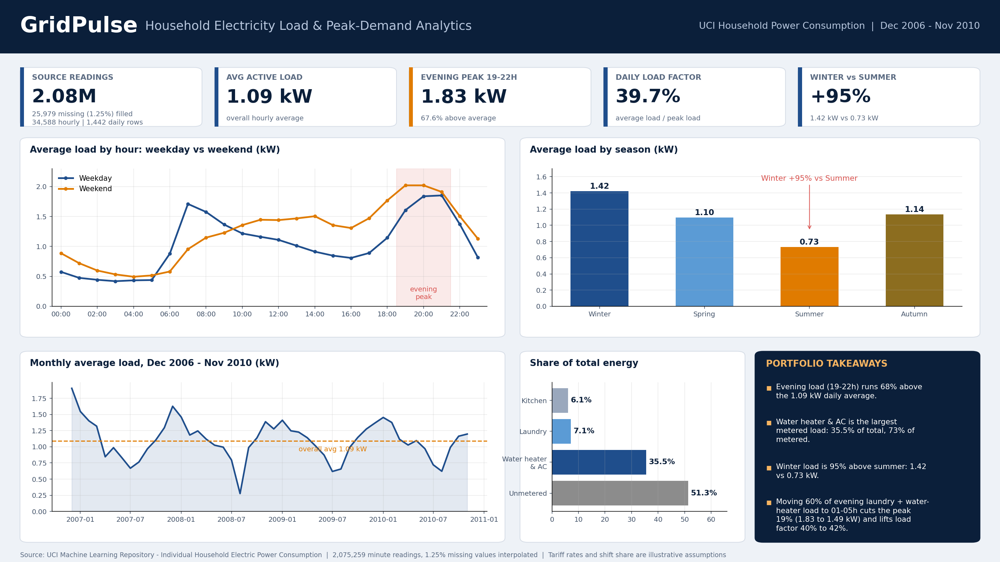

# GridPulse – Household Electricity Load & Peak-Demand Analytics

## What this project is about
I wanted to see how a single household uses electricity over the day and the year, and whether the evening peak could be reduced by moving some appliances to cheaper hours. I used the UCI *Individual Household Electric Power Consumption* dataset: one reading per minute from a house near Paris, December 2006 to November 2010.

## Data
- **2,075,259** minute-level rows (about 47 months)
- **25,979** rows (1.25%) had no sensor values (`?` in the file). 62 of the 71 gaps are an hour or shorter, the longest is about 5 days.
- Missing values were filled with linear interpolation, and the number of filled minutes is kept per hour (`imputed_minutes_count`).
- Resampled into **34,588** hourly rows and **1,442** daily rows. The last hour in the file only had 3 minutes, so I dropped it.
- Sub-metering: kitchen (1), laundry room (2), electric water heater and air-conditioning (3). Everything else is calculated as `Global_active_power × 1000 / 60 − Sub1 − Sub2 − Sub3` and called *unmetered other load*.

## Main findings
| Metric | Result |
|---|---|
| Average active load | 1.09 kW |
| Evening peak (19:00–22:00) | 1.83 kW, which is 67.6% above the average |
| Average daily load factor (average ÷ peak) | 39.7% |
| Winter vs summer | 1.42 kW vs 0.73 kW (winter about 95% higher) |
| Water heater & AC (sub-meter 3) | 35.5% of total energy, 72.9% of the metered circuits |
| Laundry (sub-meter 2) | 7.1% |
| Kitchen (sub-meter 1) | 6.1% |
| Unmetered other load | 51.3% |

**Load-shifting scenario:** if 60% of the laundry and water-heater energy used between 19:00 and 22:00 was moved to 01:00–05:00, the evening peak would drop from 1.83 kW to 1.49 kW (about 19% lower) and the daily load factor would rise from 39.7% to 42.1%. Under my assumed tariff the bill would only fall by about 3.5%, so the benefit is mostly about the peak, not the cost. Shifting 40% of that load gives roughly a 12% lower peak, and 80% gives about 25% (see the notebook table).

## Files
| File | Description |
|---|---|
| `GridPulse_Load_Analytics.ipynb` | Full analysis: cleaning, resampling, peak/season/appliance analysis, scenario, SQL checks, exports |
| `GridPulse_Load_Analysis.sql` | MySQL schema for 3 tables plus queries using CTEs, `DENSE_RANK()`, rolling `AVG() OVER` (24-hour and 7-day) and `SUM() OVER` |
| `gridpulse_powerbi_ready.csv` | Hourly data for Power BI with text columns for season, day type, tariff tier and hour label |
| `PowerBI_DAX_Measures.dax` | DAX measures for the dashboard |
| `dim_calendar.csv`, `dim_tariff_tiers.csv`, `fact_hourly_load.csv` | The three normalised tables |
| `gridpulse_dashboard.png` | Static preview of the dashboard |

## How to run
1. Download the dataset zip from UCI and put it next to the notebook (the `.txt` inside is read directly from the zip).
2. Run the notebook top to bottom (about 15 seconds).
3. To use MySQL: run the DDL at the top of the `.sql` file, then either run the `to_sql` cell in the notebook or use `LOAD DATA LOCAL INFILE` on the three CSVs. Change the password in the notebook's connection cell to your own.
4. For Power BI: import `gridpulse_powerbi_ready.csv` as a table named `Hourly Load` and paste in the measures from the `.dax` file.

## Assumptions and limitations
- Tariff rates (0.12 / 0.18 / 0.30 / 0.14 USD per kWh for off-peak / shoulder / evening / late night) are my own illustrative numbers, not the household's real prices.
- The evening peak figures use hours 19, 20 and 21 (19:00 to 21:59). The tariff tier labelled "Evening Peak (19:00-22:59)" also includes the 22:00 hour, so its average is lower.
- Seasons are meteorological, Northern Hemisphere (Winter = Dec–Feb, Summer = Jun–Aug).
- Interpolated stretches, especially the multi-day gaps, look smoother than real consumption.
- Only one household, so the patterns should not be generalised to others.
- The SQL was checked by running the same queries on an in-memory SQLite copy of the tables; the MySQL load and connection cells need a local MySQL server and were not run in the saved notebook.
